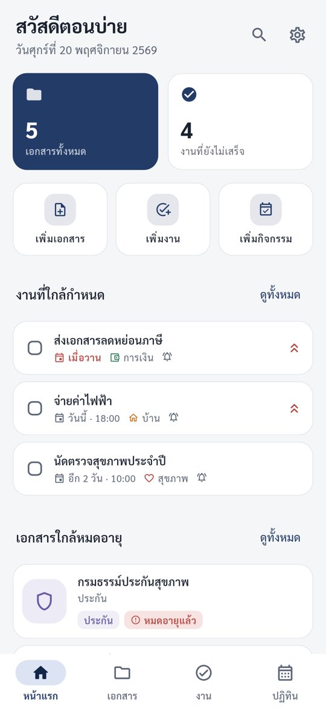
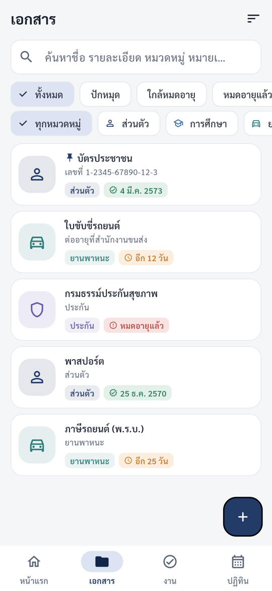
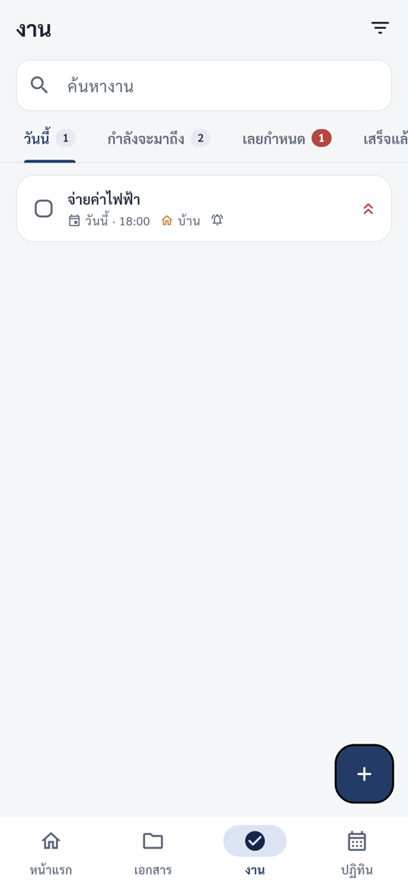
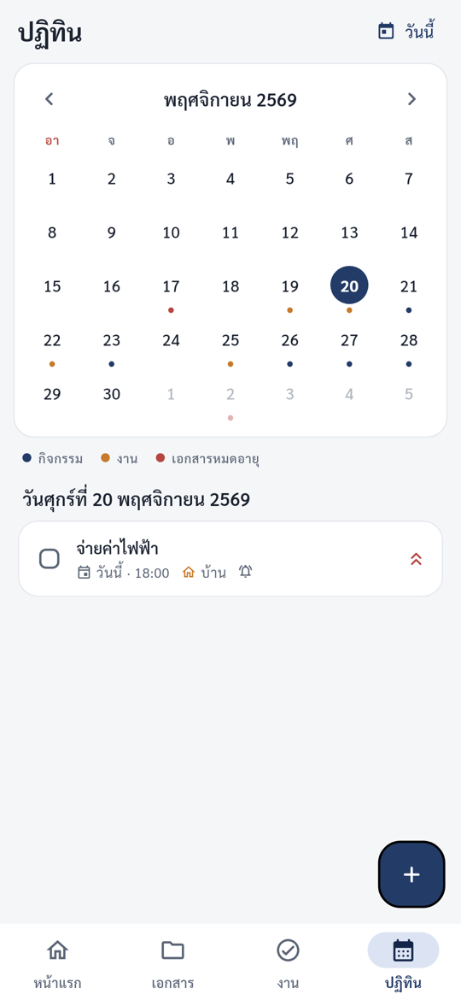
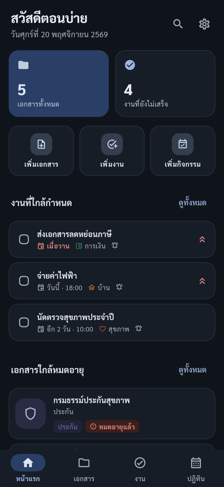

# LIFEKEEP

แอปจัดการชีวิตประจำวันแบบ **Offline-first / Privacy-first** สำหรับ Android
เก็บเอกสารสำคัญ จัดการงาน ปฏิทิน และการแจ้งเตือน — ข้อมูลทั้งหมดอยู่ในเครื่อง ไม่มีเซิร์ฟเวอร์ ไม่มี API ไม่มี AI ไม่มีโฆษณา ไม่ต้องสมัครบัญชี

| หน้าแรก | เอกสาร | งาน | ปฏิทิน | โหมดมืด |
|---|---|---|---|---|
|  |  |  |  |  |

---

## ฟีเจอร์

- **หน้าแรก (Dashboard)** — คำทักทาย วันที่ (พ.ศ.) จำนวนเอกสาร งานค้าง งานใกล้กำหนด เอกสารใกล้หมดอายุ กิจกรรม 7 วันข้างหน้า และ Quick Actions
- **เอกสาร** — เพิ่ม/แก้ไข/ลบ ค้นหา กรอง (ปักหมุด/ใกล้หมดอายุ/หมดอายุ/หมวดหมู่) เรียงลำดับ 4 แบบ วันหมดอายุ การแจ้งเตือน ปักหมุด คำอธิบาย หมายเหตุ แนบรูปหลายรูป (แกลเลอรี / กล้อง / ไฟล์) ดูรูปเต็มจอแบบซูมได้
- **งาน** — แบ่งกลุ่ม วันนี้ / กำลังจะมาถึง / เลยกำหนด / เสร็จแล้ว, ความสำคัญ ต่ำ/ปกติ/สูง, วันและเวลา, หมวดหมู่, การแจ้งเตือน, ทำเครื่องหมายเสร็จพร้อมปุ่ม “เลิกทำ”
- **ปฏิทิน** — มุมมองรายเดือน (ปัดซ้าย/ขวาเปลี่ยนเดือน) แสดงกิจกรรม งาน และวันหมดอายุเอกสาร พร้อมรายการของวันที่เลือก, เพิ่ม/แก้ไข/ลบกิจกรรม (ทั้งวัน, ช่วงหลายวัน, สถานที่, สี)
- **การแจ้งเตือน** — 1/3/7 วันก่อน, ตรงเวลา, หรือกำหนดเอง (นาที/ชั่วโมง/วัน), รองรับ Timezone, ยกเลิกของเดิมทุกครั้งที่แก้ไข/ลบ, ไม่ซ้ำ, ตั้งใหม่อัตโนมัติหลังรีบูต
- **ค้นหา** — ค้นหาแบบ Real-time ทั้งเอกสาร งาน กิจกรรม จากชื่อ รายละเอียด หมวดหมู่ หมายเหตุ สถานที่
- **ล็อกแอป** — PIN 4–6 หลัก (เก็บเป็น PBKDF2-SHA256 + salt ใน Secure Storage), ลายนิ้วมือ/ใบหน้า, ล็อกชั่วคราวเมื่อใส่ผิดหลายครั้ง, ซ่อนเนื้อหาในหน้า Recent Apps (FLAG_SECURE)
- **สำรอง/กู้คืน** — ZIP (JSON + รูปภาพ + checksum SHA-256), บันทึกไปยังตำแหน่งที่เลือก, สำรองอัตโนมัติรายวัน/รายสัปดาห์, กู้คืนแบบแทนที่หรือรวม (ไม่ซ้ำ), Rollback อัตโนมัติเมื่อผิดพลาด
- **ตั้งค่า** — ธีม (สว่าง/มืด/ตามระบบ), ภาษา (ไทย/English), การแจ้งเตือน, ล็อกแอป, สำรองข้อมูล, จัดการหมวดหมู่, พื้นที่จัดเก็บ, เกี่ยวกับ, ความเป็นส่วนตัว, ลบข้อมูลทั้งหมด (ยืนยัน 2 ขั้น)

## ความเป็นส่วนตัว

- APK แบบ Release **ไม่มีสิทธิ์ INTERNET** — แอปส่งข้อมูลออกนอกเครื่องไม่ได้ (CI ตรวจสอบข้อนี้ทุกครั้งที่ Build)
- ปิด Android Auto Backup ไปยังคลาวด์ (`allowBackup=false`, `dataExtractionRules`)
- ไฟล์สำรองไม่ได้เข้ารหัส — ผู้ใช้ควรเก็บไว้ในที่ปลอดภัย

---

## วิธีติดตั้ง APK บนโทรศัพท์

1. คัดลอก `LIFEKEEP.apk` ไปยังโทรศัพท์ Android (Android 7.0 ขึ้นไป)
2. เปิดไฟล์ → อนุญาต “ติดตั้งแอปที่ไม่รู้จัก” สำหรับแอปที่ใช้เปิดไฟล์
3. กดติดตั้ง → เปิด LIFEKEEP
4. แนะนำ: ตั้งค่า > การแจ้งเตือน → อนุญาต “แสดงการแจ้งเตือน” และ “ตั้งเวลาแบบแม่นยำ”

> APK นี้เซ็นด้วย debug key ของ Flutter (ติดตั้งใช้งานส่วนตัวได้) หากจะเผยแพร่บน Google Play ให้สร้าง keystore ของคุณเอง (ดูด้านล่าง)
> **หากเปลี่ยน key ภายหลัง จะติดตั้งทับเวอร์ชันเดิมไม่ได้** — ให้สำรองข้อมูลก่อนถอนการติดตั้ง

## วิธีเปิดโปรเจกต์

ต้องมี:

| เครื่องมือ | เวอร์ชันที่ทดสอบ |
|---|---|
| Flutter | 3.47.9 (stable) |
| Dart | 3.13.7 |
| JDK | 17 หรือ 21 |
| Android SDK | Platform/Build-tools ตามที่ Flutter ร้องขอ (ดาวน์โหลดอัตโนมัติผ่าน Gradle) |
| Android Gradle Plugin / Gradle | 9.1.1 / 9.3.1 |

```bash
cd lifekeep
flutter pub get
flutter run            # รันบนอุปกรณ์/อีมูเลเตอร์
```

เปิดด้วย Android Studio หรือ VS Code (ติดตั้ง Flutter extension) แล้วเปิดโฟลเดอร์ `lifekeep/`

## วิธี Build

```bash
cd lifekeep
flutter analyze
flutter test
flutter build apk --release
# ผลลัพธ์: build/app/outputs/flutter-apk/app-release.apk
```

### ใช้ keystore ของตนเอง (สำหรับเผยแพร่)

```bash
keytool -genkey -v -keystore ~/lifekeep-release.jks -keyalg RSA -keysize 2048 -validity 10000 -alias lifekeep
```

สร้างไฟล์ `lifekeep/android/key.properties` (ห้าม commit — อยู่ใน .gitignore แล้ว):

```properties
storePassword=<รหัสผ่าน>
keyPassword=<รหัสผ่าน>
keyAlias=lifekeep
storeFile=/home/<user>/lifekeep-release.jks
```

เมื่อมีไฟล์นี้ `flutter build apk --release` จะเซ็นด้วย key ของคุณโดยอัตโนมัติ

### Build ผ่าน GitHub Actions

Workflow `.github/workflows/lifekeep-android.yml` จะ analyze → test → build APK → ตรวจว่าไม่มีสิทธิ์ INTERNET → อัปโหลด artifact และ commit `output/LIFEKEEP.apk` กลับไปยัง branch

## การแก้ปัญหาเบื้องต้น

| ปัญหา | วิธีแก้ |
|---|---|
| `flutter doctor` แจ้งไม่พบ Android SDK | ติดตั้ง Android Studio แล้ว `flutter config --android-sdk <path>` และ `flutter doctor --android-licenses` |
| Gradle ดาวน์โหลดไม่ได้ | ต้องเข้าถึง `dl.google.com`, `maven.google.com`, `repo.maven.apache.org`, `services.gradle.org`, `storage.googleapis.com` |
| `Unsupported class file major version` | ใช้ JDK 17 หรือ 21 (`flutter config --jdk-dir <path>`) |
| การแจ้งเตือนมาช้า/ไม่มา | อนุญาตสิทธิ์ในหน้า ตั้งค่า > การแจ้งเตือน และตั้งแบตเตอรี่ของ LIFEKEEP เป็น “ไม่จำกัด” — Android อาจเลื่อนการแจ้งเตือนเมื่อประหยัดแบตเตอรี่ จึงไม่สามารถรับประกันความแม่นยำ 100% |
| เลือกรูปไม่ได้ | ตรวจสอบสิทธิ์เข้าถึงรูปภาพ/กล้องของแอปในการตั้งค่า Android |
| ลืม PIN | ไม่สามารถกู้คืนได้ (ไม่มีเซิร์ฟเวอร์) ต้องล้างข้อมูลแอป แล้วกู้คืนจากไฟล์สำรอง |
| ติดตั้งทับไม่ได้ (signature conflict) | APK เซ็นด้วย key ต่างกัน — สำรองข้อมูล ถอนการติดตั้ง แล้วติดตั้งใหม่และกู้คืน |

## Dependencies

| Package | หน้าที่ |
|---|---|
| sqflite | ฐานข้อมูล SQLite |
| path, path_provider | จัดการ path/โฟลเดอร์ของแอป |
| flutter_local_notifications, timezone, flutter_timezone | การแจ้งเตือนภายในเครื่องแบบตั้งเวลา + Timezone |
| image_picker | เลือกรูปจากแกลเลอรี (Android Photo Picker) / กล้อง |
| file_picker | เลือกไฟล์รูป, เลือกไฟล์สำรอง, บันทึกไฟล์สำรองไปยังตำแหน่งที่เลือก |
| local_auth | ลายนิ้วมือ / ใบหน้า |
| flutter_secure_storage | เก็บค่าแฮช PIN (Android Keystore) |
| archive, crypto | ZIP สำหรับไฟล์สำรอง, SHA-256, PBKDF2 |
| intl, flutter_localizations | รูปแบบวันที่ / ภาษาไทย–อังกฤษ |
| provider | State management |
| sqflite_common_ffi (dev) | รัน SQLite ในการทดสอบบนเครื่อง Linux/Mac/Windows |

## โครงสร้างโปรเจกต์

```
lib/
  main.dart, app.dart        # bootstrap, MaterialApp, theme, locale
  core/                      # theme, l10n (ไทย/อังกฤษ), utils (dates, validators, errors, formatters)
  data/
    database/                # schema + migrations (versioned)
    models/                  # DocumentItem, TaskItem, EventItem, ItemCategory, ReminderConfig
    repositories/            # SQL CRUD + search
  services/                  # notifications, reminder scheduler, attachments, backup/restore, security
  state/app_controller.dart  # จุดเดียวที่เปลี่ยนข้อมูล: DB + การแจ้งเตือน + ไฟล์ ให้สอดคล้องกัน
  ui/                        # shell, home, documents, tasks, calendar, search, settings, lock, widgets
test/                        # unit + widget tests
```

## รูปแบบไฟล์สำรอง (Backup format v1)

ไฟล์ `.zip` ประกอบด้วย:

- `manifest.json` — `format: "lifekeep-backup"`, `formatVersion`, `schemaVersion`, `appVersion`, `createdAt`, จำนวนรายการ, `dataSha256`, SHA-256 ของรูปแต่ละไฟล์
- `data.json` — documents, tasks, events, categories, settings (ไม่รวม PIN)
- `attachments/` — รูปภาพ (ถ้าเลือกให้สำรอง)

ก่อนกู้คืน ระบบตรวจ: ชนิดไฟล์ → เวอร์ชัน (ปฏิเสธไฟล์จากเวอร์ชันที่ใหม่กว่า) → checksum → โครงสร้างข้อมูลทีละรายการ (ข้ามรายการเสีย พร้อมแจ้งเตือน) → แสดงสรุปให้ยืนยัน
ระหว่างกู้คืน: สำรองข้อมูลปัจจุบันก่อน → แตกรูปไปที่ staging → เขียนฐานข้อมูลใน **transaction เดียว** + `PRAGMA integrity_check` → หากล้มเหลวจะ rollback ทั้งหมด ข้อมูลเดิมไม่เปลี่ยน

## ความเข้ากันได้ระยะยาว

- Database มี `schemaVersion` + migration ทีละขั้น ห้ามลบ/เปลี่ยนชื่อคอลัมน์ข้อมูลผู้ใช้; หากเปิดฐานข้อมูลจากเวอร์ชันที่ใหม่กว่า แอปจะหยุดโดยไม่แก้ไขข้อมูล
- ไฟล์สำรองมี `formatVersion`; เวอร์ชันใหม่ต้องอ่านเวอร์ชันเก่าได้เสมอ, field ที่ไม่รู้จักจะถูกข้าม, field ที่ขาดจะใช้ค่าเริ่มต้น
- เป็นไฟล์ ZIP + JSON มาตรฐาน อ่านได้ด้วยโปรแกรมทั่วไปแม้ไม่มีแอป

## ข้อจำกัดที่ทราบ

- สำรองอัตโนมัติทำงานเมื่อเปิดแอป/กลับเข้าแอปและถึงกำหนด (ไม่มี background job แยก) และเก็บในพื้นที่ของแอป — จะหายเมื่อถอนการติดตั้ง จึงควรส่งออกไปเก็บภายนอกเป็นประจำ
- การบันทึกไฟล์สำรองไปยังตำแหน่งที่เลือก (Storage Access Framework) ต้องโหลดไฟล์สำรองนั้นเข้าหน่วยความจำ 1 ไฟล์ชั่วคราว
- การแจ้งเตือนขึ้นกับข้อจำกัดของ Android (Doze, Battery Optimization, Exact Alarm) — ไม่รับประกันความแม่นยำ 100%
- รองรับแนบไฟล์รูปภาพ (ยังไม่รองรับ PDF)
- จอ Lock แสดงจำนวนหลักของ PIN (เพื่อส่งตรวจครั้งเดียวโดยไม่นับครั้งผิดเกิน)
